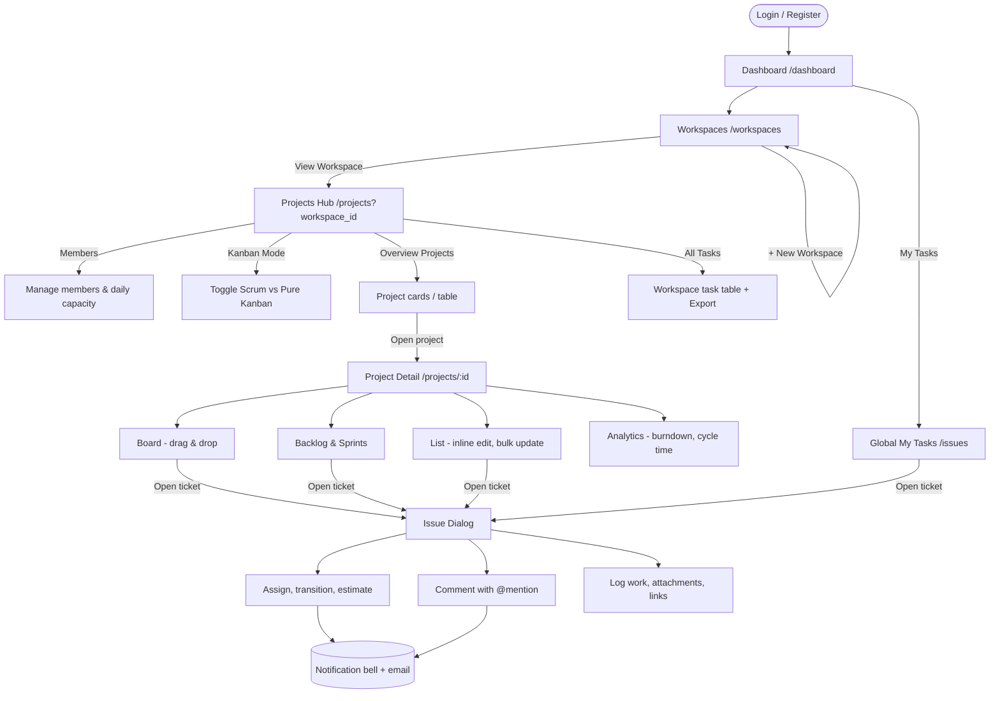

# WorkPulse (WLMS) — Application Flow & Features

This document explains how the app is used and what it can do. For setup, architecture, and testing see [README.md](README.md).

- [Application Flow](#-application-flow) — how a user moves through the app, from login to logging work on a ticket
- [Features by Module](#-features-by-module) — everything the app can do, grouped by domain
- [Roles & Access](#-roles--access-control) — who can do what
- [Route Map](#️-route-map) — pages and API endpoints at a glance

---

## 🧭 Application Flow

### Data hierarchy

Everything in WorkPulse lives inside this hierarchy. Access is checked at every level.

```
Org Unit (Group / Division)
└── Workspace                 ← top-level container, owned by an Org Unit, has members
    └── Project               ← has a key (e.g. TES), a lead, a priority, start/end dates
        ├── Sprint            ← optional (Scrum mode); planned → active → completed
        └── Issue             ← TES-13: Epic / Story / Task / Bug / Subtask
            ├── Subtasks      (parent_id)
            ├── Comments      (@mentions)
            ├── Worklogs      (time tracking)
            ├── Attachments   (max 5 MB)
            ├── Links         (BLOCKS / is blocked by)
            └── Timeline      (audit history)
```

### End-to-end user journey



### Step by step

1. **Authentication.** Users register or log in via Laravel Fortify. The flow supports email verification, password reset, two-factor authentication (TOTP), and passkeys (WebAuthn). After login the user lands on the Dashboard.

2. **Navigation.** The sidebar menu is loaded from the database and filtered by the user's roles (`menus` table, assigned per role in Settings > RBAC). Default items: Dashboard, Workspaces, Projects, Issues (My Tasks). Settings is reached from the profile menu at the bottom of the sidebar, and the Repository and Documentation links live on the login page. The header carries a language switcher (ID/EN), a theme toggle (light / dark / system), and a notification bell that receives real-time pushes over a private websocket channel (`user.{id}`).

3. **Dashboard (`/dashboard`).** The landing page shows four KPI cards (active projects, completion rate, my open tasks, overdue tasks), a _My Assigned Tasks_ panel with Semua / Overdue / Today / Upcoming filters, and a _Recent Activity_ stream from the projects the user belongs to. Activity entries show status and assignee changes by name (for example `Status: To Do → Done`).

4. **Workspaces (`/workspaces`).** The page opens with a _Member Availability_ recap: for every active workspace, each member's daily and weekly capacity, hours already allocated to their open tasks, hours still available, and open task count. This lets a lead see who has room before assigning work. Below it are cards for every workspace the user can access. A workspace is created on behalf of an Org Unit (group). From here the user can archive a workspace or open it. Only workspace members (plus Superadmin and Workspace Admin) can see what is inside.

5. **Projects Hub (`/projects?workspace_id=…`).** The hub for one workspace. The workspace is chosen by opening it from the Workspaces page; clicking Projects in the sidebar reopens the last workspace used (or the first accessible one). The page has three views:
    - **Overview Projects** — project cards (grid) or a table, searchable and filterable by priority (Low → Critical, ordered by level), each showing key, lead, progress bar, and dates. New projects are created here with a unique key that prefixes every ticket number (`KEY-N`).
    - **All Tasks** — every ticket in the workspace in one table, with quick filters (Assigned to me, To Do, In Progress, Done), search, create task, and Export to XLSX/CSV.
    - **Workspace Kanban** — a Trello-style board across all projects where new status columns and cards can be added inline.

    The header also opens the **Members** dialog (add members from candidate users, change their workspace role, set daily capacity hours, remove) and the **Kanban Mode** toggle, which switches the whole workspace between Scrum (sprints) and pure Kanban.

6. **Project Detail (`/projects/{id}`).** Day-to-day work happens here, with four tabs:
    - **Board** — Kanban columns per status. Dragging a card calls the workflow engine, which only allows transitions defined for that project's workflow. Filters by assignee, type, priority, and sprint. Done tickets older than 30 days are auto-archived from the board.
    - **Backlog** — the sprint planner. Tickets are dragged between Backlog and Sprints. Sprints are created, started, and completed (spill-over goes back to backlog or the next sprint). An estimate popover edits story points and time estimates. The _Sprint Workload_ widget compares each member's capacity (weekdays × daily hours) against allocated estimates to flag overload.
    - **List** — all project tickets in a table with search, filters, inline edit, bulk update (assign / transition), and 10/20/50/100 pagination.
    - **Analytics** — completion rate, status distribution, overdue count, burndown (ideal vs actual points), and cycle time (average / median days).

    Export (XLSX/CSV) sits in the page header, and a slide-over shows the project's activity log. Card density (S/M/L) is a global preference under Settings > Appearance.

7. **Issue lifecycle.** A ticket is created from any view with a title, type, priority, assignee, reporter, story points, original estimate, start/due dates, and an optional parent. While typing the title, _Similar Issues_ suggestions help avoid duplicates. On creation the ticket receives the next sequential number for its project. Afterwards the user can:
    - **Assign** it (triggers an in-app notification and a queued email to the assignee),
    - **Transition** its status (only valid next statuses are offered),
    - **Comment** with `@mention` autocomplete (mentioned users are notified),
    - **Log work** in `3h 45m` style and see the worklog history,
    - **Attach files** (secure download, delete),
    - **Link** it to another ticket as _blocks_ / _is blocked by_ (blocked tickets are flagged on the board),
    - **Read the timeline** of every change (audit log).

8. **Global My Tasks (`/issues`).** A cross-workspace explorer of the user's tickets with a workspace switcher, filters by project, status, priority, assignee, and due-date range, bulk actions, and pagination.

9. **Notifications.** The bell shows unread items and marks them read. Event types: `issue.assigned`, `issue.transitioned`, `comment.added`, `comment.mentioned`, `sprint.state_changed`. Each is stored in the database and broadcast via Laravel Reverb.

10. **Settings (`/settings/*`).** Profile, Security (password, 2FA, passkeys), Appearance (theme, UI density). Superadmin additionally gets RBAC (users, roles, permissions, menus), Organization (org levels and units), Workflows & Statuses (plus SLA policies), and the Documentation CMS.

11. **Admin tools.** `/admin/import-workload` uploads a CSV/XLSX of projects or issues for a target workspace. Import runs in a queued job with chunked inserts, matches PICs by NIP, email, or full name, and records per-row results in an import history with error details.

12. **Documentation (`/docs/{slug}`).** A read-only knowledge base rendered from pages written in the CMS (TipTap editor, categories, draft/published toggle).

---

## ⚡ Features by Module

### Identity — users, organization, and access

- Fortify authentication: registration, login, email verification, password reset, 2FA (TOTP with recovery codes), passkeys.
- Organization structure: org levels (e.g. Group) and org units (e.g. "Data Analyst & Data Science (DADS)").
- Dynamic RBAC: roles with a scope (`GLOBAL`, `WORKSPACE`, `PROJECT`), permissions (`workspaces:manage`, `issues:assign`, `sprints:manage`, …), and menu visibility per role.
- User management: create single users, bulk-add users, assign a default org unit, assign/revoke context-scoped roles.
- `Superadmin` is a protected system role (cannot be renamed or deleted) and bypasses all gates.

### Workload — workspaces, projects, sprints, issues

- Workspaces: create, update, archive; owned by an org unit; member list with per-member role and `daily_capacity_hours`; member-candidate lookup; member availability recap (weekly capacity vs allocated estimates); per-workspace settings (Kanban mode, SLA days by priority, SLA warning days).
- Projects: create/update/archive with key, name, description, lead, priority, start/end dates; progress and health metrics; project lookups (types, priorities, statuses, members).
- Sprints: create, update, start, complete; sprint workload (capacity vs allocation per member).
- Issues: full CRUD with soft delete; types Epic / Story / Task / Bug / Subtask; priorities Lowest → Critical; story points and time estimates; parent/subtask hierarchy; custom fields; similar-issue detection; serialized ticket numbering (`PROJ-N`).
- Workflow engine: workflows, statuses (with categories TODO / IN_PROGRESS / DONE), and allowed transitions. The board and bulk updates both enforce them.
- Board & backlog queries with filters, auto-archive of stale Done tickets, and a 500-item page size so boards are never silently truncated.
- Worklogs: log work per ticket, history per ticket, timesheet export per workspace or project.
- Attachments: upload (max 5 MB), secure download, delete, anti-IDOR checks.
- Issue links: `BLOCKS` relationships with blocked flags surfaced in the UI.
- Export: issues and timesheets as XLSX or CSV, streamed to the browser.
- Import: asynchronous CSV/XLSX import of projects and issues with PIC matching and an observable history.
- Analytics: workspace-level (active projects, completion, overdue, per-member utilization, project health) and project-level (burndown, distribution, cycle time).
- Dashboard query aggregating KPIs, personal tasks by urgency, and recent activity.

### Collaboration — comments and audit

- Comments on issues with edit; `@mention` autocomplete and highlighting.
- Issue timeline combining audit log entries (assignment, transition, field changes) and comments.
- Audit log of every domain event for traceability.

### Notification — in-app alerts

- Database-backed notifications with unread state and mark-all-read.
- Real-time broadcast over a private per-user channel (Laravel Reverb / Echo).
- Queued email on assignment (`IssueAssignedMail`).

### KnowledgeBase — documentation CMS

- Categories and pages with slugs, draft/published state, and a rich-text (TipTap) editor.
- Reader at `/docs/{slug}` for authenticated users; admin at `/settings/docs` with search, sort, filter, pagination.

### Cross-cutting

- Multi-language UI (Bahasa Indonesia default, English) via `lang/*.json` and a `useTranslate` hook; locale persisted per user.
- Theme (light/dark/system) and S/M/L density preferences.
- Context-aware RBAC enforced centrally in `WorkloadAccessChecker` for every workspace/project read and write.

---

## 🔐 Roles & Access Control

Roles are data, not code, but the simulation seeder ships these five and the UI is designed around them.

| Role                        | Scope     | Can                                                                                                                                                | Cannot                                                             |
| --------------------------- | --------- | -------------------------------------------------------------------------------------------------------------------------------------------------- | ------------------------------------------------------------------ |
| **Superadmin**              | Global    | Everything: org structure, roles/permissions/menus, docs CMS, imports, override any workspace/project/issue                                        | —                                                                  |
| **Workspace Owner / Admin** | Workspace | Edit/archive the workspace, manage members and their roles, create projects, assign project leads, view cross-project analytics                    | Change global settings, delete org units                           |
| **Project Lead**            | Project   | Configure workflow transitions, create/start/complete sprints, groom backlog, bulk update, edit any ticket, moderate comments, soft-delete tickets | Delete the parent workspace                                        |
| **Developer / Member**      | Project   | Create tickets, comment (own), log work (own), move tickets along allowed transitions, link tickets, attach files                                  | Edit others' comments, delete tickets, manage sprints or workflows |
| **Guest / Reporter**        | Project   | Report tickets, read and comment on their own tickets                                                                                              | Log work, see the backlog, move tickets freely                     |

Anti-IDOR rule: a user who is not a member of a workspace (and not Superadmin / Workspace Admin) gets `403` on every endpoint of that workspace, even with a valid UUID. A regular member only sees projects where they are lead, hold a project-scoped role, or are assigned to an issue.

Simulation users (`php artisan db:seed --class=RbacSimulationSeeder`, password `password`): `superadmin@wlms.com`, `owner@wlms.com`, `lead@wlms.com`, `dev@wlms.com`, `guest@wlms.com`.

### Seeded lookups (`WorkloadLookupSeeder`)

| Issue types                     | Priorities (level)                                                                                 | Statuses (category)                                                      |
| ------------------------------- | -------------------------------------------------------------------------------------------------- | ------------------------------------------------------------------------ |
| Epic, Story, Task, Bug, Subtask | Low (2), Medium (3), High (4), Critical (5); Lowest (1) is seeded inactive and hidden from pickers | To Do (TODO) · In Progress, In Review, In QA (IN_PROGRESS) · Done (DONE) |

---

## 🗺️ Route Map

### Pages (Inertia)

| Path                                                                                | Page                                                |
| ----------------------------------------------------------------------------------- | --------------------------------------------------- |
| `/`                                                                                 | Welcome                                             |
| `/login`, `/register`, `/forgot-password`, `/two-factor-challenge`                  | Auth (Fortify)                                      |
| `/dashboard`                                                                        | Dashboard                                           |
| `/workspaces`                                                                       | Workspace cards                                     |
| `/workspaces/{id}/issues`                                                           | Workspace tasks                                     |
| `/projects?workspace_id=…`                                                          | Projects hub (Overview / All Tasks / Kanban)        |
| `/projects/{id}`                                                                    | Project detail (Board / Backlog / List / Analytics) |
| `/issues`                                                                           | Global My Tasks                                     |
| `/settings/profile`, `/settings/security`, `/settings/appearance`                   | User settings                                       |
| `/settings/rbac`, `/settings/organization`, `/settings/workflows`, `/settings/docs` | Admin settings (Superadmin)                         |
| `/admin/import-workload`                                                            | Spreadsheet import (Superadmin)                     |
| `/docs/{slug?}`                                                                     | Documentation reader                                |

### API (`/api/*`, session-authenticated)

| Resource                | Endpoints                                                                                                                                                                                                                                           |
| ----------------------- | --------------------------------------------------------------------------------------------------------------------------------------------------------------------------------------------------------------------------------------------------- |
| Workspaces              | `GET/POST /workspaces`, `PUT/DELETE /workspaces/{id}`, `GET …/projects`, `GET …/issues`, `GET …/issues/export`, `GET …/timesheets/export`, `GET …/analytics`, `GET …/availability`, `GET/PUT …/settings`                                            |
| Workspace members       | `GET …/members`, `GET …/member-candidates`, `POST …/members`, `PUT/DELETE …/members/{user_id}`                                                                                                                                                      |
| Projects                | `POST /projects`, `PUT/DELETE /projects/{id}`, `GET …/board`, `GET …/backlog`, `GET/POST …/issues`, `GET …/issues/similar`, `GET …/issues/export`, `GET …/timesheets/export`, `GET …/activity`, `GET …/sprints`, `GET …/lookups`, `GET …/analytics` |
| Sprints                 | `POST /sprints`, `PUT /sprints/{id}`, `PUT …/start`, `PUT …/complete`, `GET …/workload`                                                                                                                                                             |
| Issues                  | `POST /issues`, `GET/PUT/DELETE /issues/{id}`, `POST …/assign`, `POST …/transition`, `GET …/transitions`, `GET/POST …/worklogs`, `GET/POST …/attachments`, `GET/POST …/links`, `DELETE …/links/{linkId}`, `POST /issues/bulk-update`                |
| Attachments             | `GET /attachments/{id}/download`, `DELETE /attachments/{id}`                                                                                                                                                                                        |
| Statuses & workflows    | `GET/POST /statuses`, `PUT/DELETE /statuses/{id}`, `GET/POST /workflows`, `GET/PUT/DELETE /workflows/{id}`, `POST …/transitions`, `DELETE …/transitions/{id}`                                                                                       |
| Collaboration           | `GET /issues/{id}/timeline`, `GET/POST /issues/{id}/comments`, `PUT /issues/{id}/comments/{commentId}`                                                                                                                                              |
| Notifications           | `GET /notifications`, `PUT /notifications/read`                                                                                                                                                                                                     |
| Settings                | `GET/PUT /settings/workload`                                                                                                                                                                                                                        |
| RBAC & org (Superadmin) | `/rbac/roles`, `/rbac/permissions`, `/rbac/menus`, `/rbac/users`, `/rbac/user-roles/{assign,revoke}`, `/org-levels`, `/org-units`                                                                                                                   |

Module route files: `app/Modules/*/Presentation/Http/routes.php`, plus `routes/web.php` and `routes/settings.php`. Detailed API contracts live in [doc/](doc/).

---

## 📚 Further Reading

[README.md](README.md) covers architecture, tech stack, installation, and the test suite. The [doc/](doc/) folder holds functional specs (FSD), API contracts, UAT scripts, and user guides per feature, plus [Roadmap-And-TechnicalDebt.md](doc/Roadmap-And-TechnicalDebt.md) and the original [workspace-user-flow.md](doc/workspace-user-flow.md) (Bahasa Indonesia).
