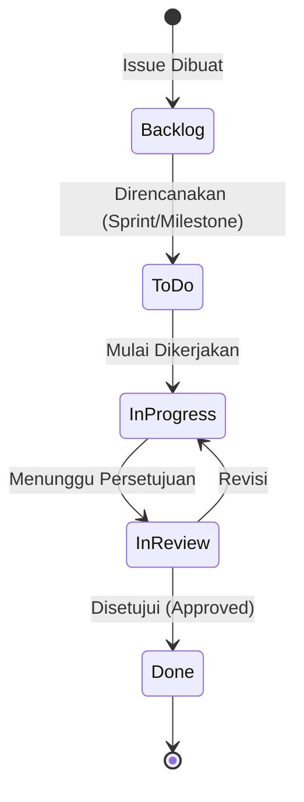

# FUNCTIONAL SPECIFICATION DOCUMENT (FSD)

**Modul:** Issues / Ticketing Management
**Proyek:** Workload Management System (WLMS)
**Tanggal Dokumen:** 17 September 2026
**Versi:** 1.0.0
**Klasifikasi:** Rahasia / Internal (Confidential)

## 1. INFORMASI KONTROL DOKUMEN

| Versi | Tanggal     | Penulis          | Deskripsi Perubahan                 | Disetujui Oleh |
| ----- | ----------- | ---------------- | ----------------------------------- | -------------- |
| 1.0.0 | 17-Sep-2026 | Technical Writer | Inisiasi FSD Modul Issues/Ticketing | VP Engineering |

## 2. PENDAHULUAN

### 2.1 Latar Belakang

Modul Issues / Ticketing Management merupakan komponen esensial dalam tata kelola operasional dan pengembangan perangkat lunak (SDLC). Modul ini bertujuan untuk mencatat, melacak, dan menyelesaikan setiap kendala, _bug_, atau penugasan (tugas/isu) yang terkait dengan suatu _Project_ atau _Workspace_.

### 2.2 Tujuan

Menyediakan landasan spesifikasi fungsional untuk memastikan bahwa pengembangan dan implementasi fitur pelacakan isu berjalan selaras dengan kebijakan tata kelola TI (_IT Governance_), termasuk kontrol akses keamanan berlapis (RBAC).

## 3. ATURAN BISNIS (BUSINESS RULES)

### 3.1 Relasi Entitas Utama

- **Project to Issues:** Satu _Project_ dapat memiliki banyak _Issues_ (1:N). _Issue_ tidak dapat berdiri sendiri tanpa _Project_.
- **User to Issues (Reporter):** Satu _User_ dapat melaporkan banyak _Issues_ (1:N).
- **User to Issues (Assignee):** Satu _Issue_ dapat ditugaskan ke satu atau beberapa _User_ yang tergabung dalam _Project_ terkait (N:M).
- **Status Lifecycle:** Setiap _Issue_ memiliki _Status_ yang terikat pada _Workflow_ tertentu (contoh: _Backlog_ -> _To Do_ -> _In Progress_ -> _In Review_ -> _Done_).

### 3.2 Otorisasi & Validasi (Keamanan)

- **BR-ISS-01:** Hanya pengguna dengan _Role_ minimal `Project Member` pada _Project_ tersebut yang berhak membuat _Issue_.
- **BR-ISS-02 (Anti-IDOR):** Pengguna **dilarang keras** mengubah atau melihat _Issue_ di _Project_ yang bukan merupakan wewenangnya. Validasi harus diimplementasikan di level infrastruktur (Backend / API).
- **BR-ISS-03:** _Status_ hanya dapat diubah oleh _Assignee_, _Project Manager_, atau peran dengan hak akses lebih tinggi (_Manager/VP/Director_).

### 3.3 Aturan Bisnis Komentar (Issue Comments)

- **BR-ISS-04:** Setiap _Issue_ dapat memiliki banyak komentar (1:N).
- **BR-ISS-05:** Pengguna hanya dapat menambahkan komentar pada _Issue_ yang ada di dalam _Project_ yang berhak diaksesnya.
- **BR-ISS-06:** Komentar tidak dapat diubah (immutable) setelah dikirim, demi menjaga rekam jejak audit (audit trail).
- **BR-ISS-07:** _User_ akan menerima notifikasi jika ada komentar baru pada _Issue_ yang ditugaskan kepadanya atau yang dilaporkannya.

## 4. DIAGRAM ALUR (MERMAID DIAGRAM)

### 4.1 State Diagram: Siklus Hidup Issue (Issue Lifecycle)

### 4.2 Sequence Diagram: Pembuatan Issue

```mermaid
sequenceDiagram
    actor User as Project Member
    participant UI as Frontend App
    participant API as Backend API
    participant DB as Database

    User->>UI: Mengisi Form Pembuatan Issue
    UI->>API: POST /api/v1/projects/{id}/issues
    API->>API: Verifikasi Token & RBAC
    API->>API: Validasi Anti-IDOR (Apakah user akses Project ini?)
    alt Akses Ditolak
        API-->>UI: 403 Forbidden (Data Breach Prevented)
        UI-->>User: Tampilkan Error
    else Akses Diizinkan
        API->>DB: DB::transaction -> INSERT INTO issues
        DB-->>API: Success
        API-->>UI: 201 Created (Data Issue)
        UI-->>User: Notifikasi "Issue Berhasil Dibuat"
    end
```

## 5. KEBUTUHAN ANTARMUKA

Antarmuka pengguna harus mengadopsi standar _Clean UI_ dan memisahkan _server state_ (via React Query) untuk mencegah _stale data_ pada Kanban Board. Komponen form harus membaca _maxLength_ dari spesifikasi API.

## 6. PERSETUJUAN

Dokumen ini dianggap sah setelah ditandatangani oleh pemangku kepentingan.

_(Tanda Tangan Elektronik / Approval Workflow Terlampir)_

## 4. Sprint Planning & Backlog

- **Drag & Drop**: Menggunakan dnd-kit.
- **Sprint Lifecycle**: PENDING -> ACTIVE -> COMPLETED.
- **Anti-Overlap**: Hanya boleh 1 sprint ACTIVE per project.
