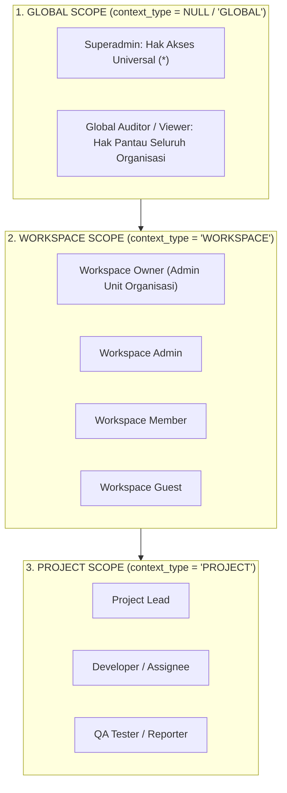

# Context-Aware RBAC Access Control Matrix

## Workload & Learning Management System (WLMS)

Dokumen ini mendefinisikan arsitektur dan matriks perizinan kontrol akses berbasis peran berorientasi konteks (_Context-Aware Role-Based Access Control_).

---

## 1. Konsep Tiga Tingkat Cakupan Konteks (Context Scopes)

Pengguna dapat memiliki peran yang berbeda pada entitas yang berbeda tanpa tumpang tindih hak akses:

---

## 2. Logika Resolusi Otorisasi (`WorkloadAccessChecker`)

Hak akses terhadap suatu resource diverifikasi secara deterministik melalui aturan berjenjang:

1. **Superadmin Bypass**: Jika email bernilai `superadmin@wlms.com` atau memiliki role `Superadmin` di level `GLOBAL`, seluruh operasi lolos validasi.
2. **Workspace Ownership & Membership**:
    - Jika unit organisasi pengguna (`users.org_unit_id`) cocok dengan pemilik workspace (`workspaces.owner_group_id`), pengguna memiliki akses penuh ke workspace dan seluruh proyek di dalamnya.
    - Jika pengguna terdaftar di tabel `workspace_members` untuk workspace tersebut, pengguna memiliki hak akses sesuai perannya (`admin`, `member`, `guest`).
3. **Project Context Grant**:
    - Jika pengguna adalah `projects.lead_id`.
    - Jika pengguna memiliki penugasan role khusus pada proyek (`context_type = 'PROJECT'` dan `context_id = $projectId`).
    - Jika pengguna merupakan penanggung jawab tiket aktif dalam proyek (`issues.assignee_id = $userId`).

---

## 3. Matriks Perizinan vs Peran (Permissions Matrix)

| Izin (_Permission_)                                   | Superadmin | Workspace Owner | Workspace Admin | Project Lead  |       Member       |     Guest     |
| ----------------------------------------------------- | :--------: | :-------------: | :-------------: | :-----------: | :----------------: | :-----------: |
| **Universal Bypass (`*`)**                            |     ✅     |       ❌        |       ❌        |      ❌       |         ❌         |      ❌       |
| **`rbac:manage`** (Kelola User, Role, Unit)           |     ✅     |       ❌        |       ❌        |      ❌       |         ❌         |      ❌       |
| **`workspaces:view`**                                 |     ✅     |  ✅ (Miliknya)  |  ✅ (Miliknya)  | ✅ (Miliknya) |   ✅ (Miliknya)    | ✅ (Terbatas) |
| **`workspaces:manage`** (Edit/Hapus Workspace)        |     ✅     |       ✅        |       ❌        |      ❌       |         ❌         |      ❌       |
| **`workspaces:members:manage`** (Tambah/Hapus Member) |     ✅     |       ✅        |       ✅        |      ❌       |         ❌         |      ❌       |
| **`projects:view`**                                   |     ✅     |       ✅        |       ✅        |      ✅       |    ✅ (Terkait)    | ✅ (Terkait)  |
| **`projects:manage`** (Buat/Edit/Arsip Proyek)        |     ✅     |       ✅        |       ✅        |      ✅       |         ❌         |      ❌       |
| **`issues:view`**                                     |     ✅     |       ✅        |       ✅        |      ✅       |         ✅         |      ✅       |
| **`issues:create`**                                   |     ✅     |       ✅        |       ✅        |      ✅       |         ✅         |      ❌       |
| **`issues:manage`** (Edit Judul/Deskripsi/Status)     |     ✅     |       ✅        |       ✅        |      ✅       | ✅ (Tiket Sendiri) |      ❌       |
| **`issues:assign`** (Ganti PIC Tiket)                 |     ✅     |       ✅        |       ✅        |      ✅       |         ❌         |      ❌       |
| **`issues:delete`** (Hapus Tiket)                     |     ✅     |       ✅        |       ✅        |      ✅       |         ❌         |      ❌       |
| **`sprints:manage`** (Buat/Start/Complete Sprint)     |     ✅     |       ✅        |       ✅        |      ✅       |         ❌         |      ❌       |
| **`worklogs:create`** (Catat Jam Kerja)               |     ✅     |       ✅        |       ✅        |      ✅       |         ✅         |      ❌       |
| **`comments:create`** (Komentar Tiket)                |     ✅     |       ✅        |       ✅        |      ✅       |         ✅         |      ❌       |

---

## 4. Perlindungan Sistem Khusus

1. **Imutabilitas Role Superadmin**:
    - Role `Superadmin` tidak dapat diubah namanya maupun dihapus (`DELETE /api/rbac/roles/{id}` mengembalikan HTTP 422).
    - Tombol hapus role `Superadmin` otomatis dinonaktifkan di frontend ([`RoleList.tsx`](file:///Users/robileksono/Sites/wlms/resources/js/modules/Identity/components/RoleList.tsx)).
2. **Normalisasi Case Konteks**:
    - Nilai parameter `context_type` pada endpoint penugasan dinormalisasi menjadi huruf kapital (`GLOBAL`, `WORKSPACE`, `PROJECT`) melalui controller dan migrasi database untuk menghindari inkonsistensi pencarian.
