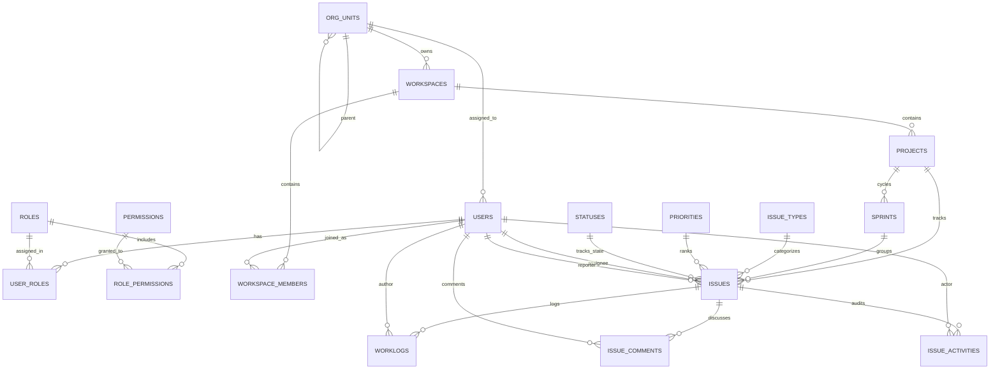

# Entity Relationship Diagram (ERD) & Data Dictionary

## Workload & Learning Management System (WLMS)

Dokumen ini mendefinisikan skema fisik basis data relasional, diagram hubungan antar entitas (_Entity-Relationship Diagram_), dan kamus data (_Data Dictionary_) sistem WLMS.

---

## 1. Diagram Relasi Entitas (Mermaid ERD)

---

## 2. Kamus Data (Data Dictionary)

### 2.1 Modul Identity & Keamanan

#### Tabel: `users`

Menyimpan akun pengguna sistem.

| Kolom         | Tipe Data                | Constraints                       | Deskripsi                                             |
| ------------- | ------------------------ | --------------------------------- | ----------------------------------------------------- |
| `id`          | BIGINT (Auto Inc) / UUID | PK                                | Identitas unik pengguna.                              |
| `name`        | VARCHAR(255)             | NOT NULL                          | Nama lengkap pengguna.                                |
| `email`       | VARCHAR(255)             | UNIQUE, NOT NULL                  | Alamat email unik (login credential).                 |
| `employee_id` | VARCHAR(100)             | NULLABLE                          | NIP / Nomor Induk Pegawai untuk resolusi impor Excel. |
| `org_unit_id` | UUID                     | FK $\to$ `org_units.id`, NULLABLE | Unit organisasi utama tempat user bernaung.           |
| `password`    | VARCHAR(255)             | NOT NULL                          | Hash kata sandi (Bcrypt / Argon2).                    |
| `locale`      | VARCHAR(10)              | DEFAULT 'en'                      | Preferensi bahasa antarmuka (`en` / `id`).            |

#### Tabel: `roles` & `permissions`

Menyimpan master peran dan perizinan.

- `roles`: `id` (UUID), `name` (VARCHAR), `scope` (`GLOBAL`, `WORKSPACE`, `PROJECT`), `description` (TEXT).
- `permissions`: `id` (UUID), `name` (VARCHAR, UNIQUE), `description` (TEXT).
- `user_roles`: `id` (UUID), `user_id` (FK $\to$ `users`), `role_id` (FK $\to$ `roles`), `context_type` (VARCHAR: `GLOBAL`, `WORKSPACE`, `PROJECT`), `context_id` (VARCHAR, NULLABLE). Indeks komposit pada `(user_id, role_id, context_type, context_id)`.

#### Tabel: `org_units` & `org_unit_closures`

Menyimpan hierarki struktur organisasi menggunakan _Closure Table_.

- `org_units`: `id` (UUID, PK), `name` (VARCHAR), `code` (VARCHAR, UNIQUE), `parent_id` (FK self-reference), `org_level_id` (FK), `is_active` (BOOLEAN).
- `org_unit_closures`: `ancestor_id` (UUID, FK $\to$ `org_units`), `descendant_id` (UUID, FK $\to$ `org_units`), `depth` (INT, NOT NULL). PK Komposit `(ancestor_id, descendant_id)`.

---

### 2.2 Modul Workload Management

#### Tabel: `workspaces` & `workspace_members`

- `workspaces`: `id` (UUID, PK), `name` (VARCHAR), `slug` (VARCHAR, UNIQUE), `owner_group_id` (UUID, FK $\to$ `org_units.id`), `status` (VARCHAR: `ACTIVE`, `ARCHIVED`).
- `workspace_members`: `workspace_id` (UUID, FK), `user_id` (BIGINT, FK), `role` (VARCHAR: `admin`, `member`, `guest`), `daily_capacity_seconds` (INT, DEFAULT 28800 = 8 jam). PK Komposit `(workspace_id, user_id)`.

#### Tabel: `projects`

Menyimpan proyek tim.

| Kolom          | Tipe Data    | Constraints                   | Deskripsi                               |
| -------------- | ------------ | ----------------------------- | --------------------------------------- |
| `id`           | UUID         | PK                            | Identitas unik proyek.                  |
| `workspace_id` | UUID         | FK $\to$ `workspaces.id`      | Workspace penaung proyek.               |
| `name`         | VARCHAR(255) | NOT NULL                      | Nama proyek.                            |
| `key`          | VARCHAR(10)  | NOT NULL                      | Kunci unik proyek (misal: `PRJ`, `IT`). |
| `lead_id`      | BIGINT       | FK $\to$ `users.id`, NULLABLE | Penanggung jawab teknis proyek.         |
| `start_date`   | DATE         | NULLABLE                      | Tanggal mulai proyek.                   |
| `end_date`     | DATE         | NULLABLE                      | Target selesai proyek.                  |
| `status`       | VARCHAR(50)  | DEFAULT 'ACTIVE'              | Status proyek (`ACTIVE`, `ARCHIVED`).   |
| `deleted_at`   | TIMESTAMP    | NULLABLE                      | Penanda _soft delete_.                  |

#### Tabel: `sprints`

Menyimpan siklus iterasi kerja Scrum/Kanban.

- `id` (UUID, PK), `project_id` (UUID, FK $\to$ `projects.id`), `name` (VARCHAR), `goal` (TEXT), `state` (VARCHAR: `PENDING`, `ACTIVE`, `COMPLETED`), `start_date` (TIMESTAMP), `end_date` (TIMESTAMP).

#### Tabel: `issues`

Menyimpan tiket tugas inti dalam sistem.

| Kolom                        | Tipe Data    | Constraints                      | Deskripsi                                            |
| ---------------------------- | ------------ | -------------------------------- | ---------------------------------------------------- |
| `id`                         | UUID         | PK                               | Identitas unik tiket.                                |
| `project_id`                 | UUID         | FK $\to$ `projects.id`, NOT NULL | Proyek pemilik tiket.                                |
| `sprint_id`                  | UUID         | FK $\to$ `sprints.id`, NULLABLE  | Sprint tempat tiket dijadwalkan (NULL = Backlog).    |
| `number`                     | INT          | NOT NULL                         | Nomor urut sekuensial dalam proyek (`PRJ-1`).        |
| `title`                      | VARCHAR(255) | NOT NULL                         | Judul ringkas tugas.                                 |
| `description`                | TEXT         | NULLABLE                         | Penjelasan rinci atau kriteria tugas.                |
| `issue_type_id`              | UUID         | FK $\to$ `issue_types.id`        | Jenis tiket (`Task`, `Bug`, `Story`).                |
| `priority_id`                | UUID         | FK $\to$ `priorities.id`         | Tingkat urgensi (`Low`, `Medium`, `High`, `Urgent`). |
| `status_id`                  | UUID         | FK $\to$ `statuses.id`           | Status alur kerja tiket saat ini.                    |
| `assignee_id`                | BIGINT       | FK $\to$ `users.id`, NULLABLE    | PIC penanggung jawab tiket.                          |
| `reporter_id`                | BIGINT       | FK $\to$ `users.id`, NOT NULL    | Pembuat tiket.                                       |
| `original_estimate_seconds`  | INT          | NULLABLE                         | Estimasi waktu awal (dalam detik).                   |
| `remaining_estimate_seconds` | INT          | NULLABLE                         | Sisa waktu pengerjaan (dalam detik).                 |
| `start_date`                 | DATE         | NULLABLE                         | Tanggal mulai pengerjaan tugas.                      |
| `due_date`                   | DATE         | NULLABLE                         | Tenggat waktu penyelesaian tugas.                    |
| `deleted_at`                 | TIMESTAMP    | NULLABLE                         | Penanda _soft delete_.                               |

#### Tabel: `worklogs`

Pencatatan waktu kerja riil (_timesheet_).

- `id` (UUID, PK), `issue_id` (UUID, FK $\to$ `issues.id`), `author_id` (BIGINT, FK $\to$ `users.id`), `time_spent_seconds` (INT, NOT NULL), `description` (TEXT), `started_at` (TIMESTAMP).

---

### 2.3 Modul Collaboration

#### Tabel: `issue_comments`

- `id` (UUID, PK), `issue_id` (UUID, FK $\to$ `issues.id`), `user_id` (BIGINT, FK $\to$ `users.id`), `body` (TEXT, NOT NULL), `created_at`, `updated_at`.

#### Tabel: `issue_activities`

Audit trail perubahan atribut tiket.

- `id` (BIGINT/UUID, PK), `issue_id` (UUID, FK $\to$ `issues.id`), `user_id` (BIGINT, FK $\to$ `users.id`, NULLABLE), `action_type` (VARCHAR: `status_changed`, `assigned`, `created`, `worklog_logged`), `old_value` (VARCHAR), `new_value` (VARCHAR), `created_at` (TIMESTAMP).
