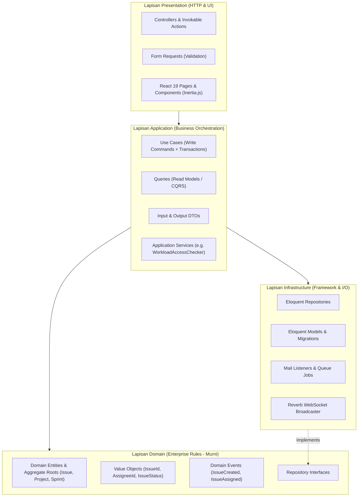
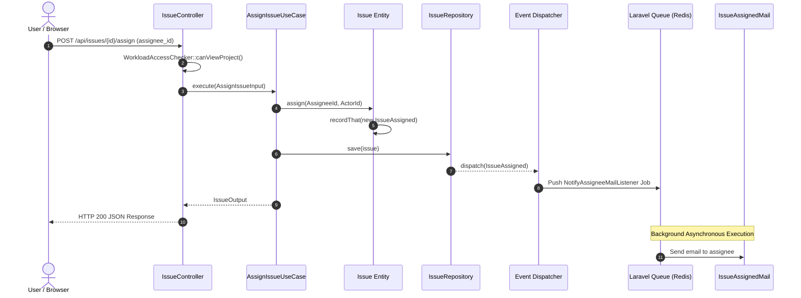

# Software Architecture Document (SAD)

## Workload & Learning Management System (WLMS)

**Arsitektur:** Modular Monolith  
**Pola Desain:** Clean Architecture + Pragmatic CQRS + Domain-Driven Design (DDD)  
**Framework:** Laravel 11 (PHP 8.2+) & React 19 (Inertia.js + TypeScript)

---

## 1. Ikhtisar Arsitektur

WLMS dibangun dengan arsitektur **Modular Monolith** untuk menggabungkan kesederhanaan deployment monolitik dengan ketatnya batas isolasi domain ala microservices.

---

## 2. Batas Isolasi Modul (Modular Monolith)

Kode sumber dikelompokkan ke dalam direktori modul mandiri di bawah `app/Modules/`:

1. **`App\Modules\Identity`**:
    - Menangani autentikasi, model pengguna (`UserModel`), peran & izin (`RoleModel`, `PermissionModel`), dan struktur pohon organisasi (`OrgUnitModel`, `OrgUnitTreeService`).
2. **`App\Modules\Workload`**:
    - Inti operasional bisnis: Workspace, Proyek, Tiket Tugas, Sprint, dan analitik beban kerja.
3. **`App\Modules\Collaboration`**:
    - Ruang diskusi tiket: Komentar berulir (`IssueCommentModel`) dan audit trail linimasa tiket (`issue_activities`).
4. **`App\Modules\KnowledgeBase`**:
    - Dokumentasi sistem internal dan basis pengetahuan.
5. **`App\Modules\Notification`**:
    - Notifikasi in-app real-time dan orkestrasi broadcast WebSocket.

### Aturan Ketergantungan Antar Modul (Enforced via Pest Arch):

- Domain entity dilarang mengimpor kelas dari modul lain secara langsung.
- Modul dilarang membypass batas abstraksi (ditegakkan otomatis pada `tests/Arch/ArchitectureTest.php`).
- Namespace `App\Shared` dilarang bergantung pada modul spesifik.

---

## 3. Pola Pragmatic CQRS

Untuk mencapai keseimbangan antara integritas transaksional dan performa baca yang tinggi, sistem memisahkan alur tulis (_Write/Command_) dan alur baca (_Read/Query_):

### 3.1 Alur Write (Commands / Use Cases)

- **Karakteristik**: Berorientasi tugas (_Task-based_), diatur dalam transaksi database (`DB::transaction`).
- **Mekanisme**:
    1. Controller menerima `FormRequest` dan memvalidasi tipe data.
    2. Controller merakit `InputDTO` dan memanggil `UseCase->execute()`.
    3. Use Case memuat Entity dari `RepositoryInterface`.
    4. Entity mengeksekusi metode mutasi domain dan merekam _Domain Event_.
    5. Repository menyimpan Entity dan me-release event ke Laravel Event Dispatcher.
    6. Listener asinkron mengeksekusi efek samping (kirim email via queue, broadcat WebSocket).

### 3.2 Alur Read (Queries)

- **Karakteristik**: Dioptimalkan untuk performa kueri layar (_Screen-oriented_), memotong overhead rekonstruksi entity domain.
- **Mekanisme**:
    1. Controller memanggil kelas Query khusus (misal: `GetWorkspaceIssuesQuery`, `GetBoardIssuesQuery`).
    2. Query langsung menggunakan `DB::table(...)` atau Eloquent dengan _eager loading_ dan _selective columns_.
    3. Mengembalikan array data siap render ke Inertia atau JSON API.

---

## 4. Mekanisme Event & Background Workers

---

## 5. Strategi Database & Indeks

- **Penyimpanan Pohon**: `org_unit_closures` menggunakan skema Closure Table `(ancestor_id, descendant_id, depth)` dengan indeks komposit primer.
- **Indeks Filter Kunci**:
    - `issues(project_id, sprint_id, status_id, deleted_at)`: Menjamin kueri Kanban dan Backlog berjalan di bawah 10ms.
    - `issues(assignee_id, due_date)`: Menjamin kueri "My Tasks" di dashboard berjalan instan.
- **Integritas Referensial**: _Foreign Keys_ dengan `ON DELETE CASCADE` atau `RESTRICT` yang terdefinisi eksplisit di level DDL database.
