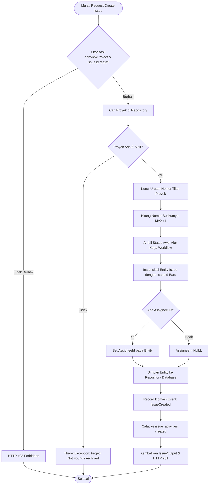
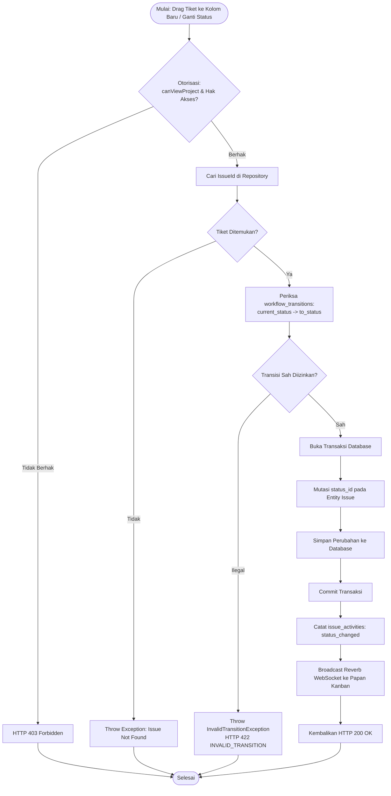
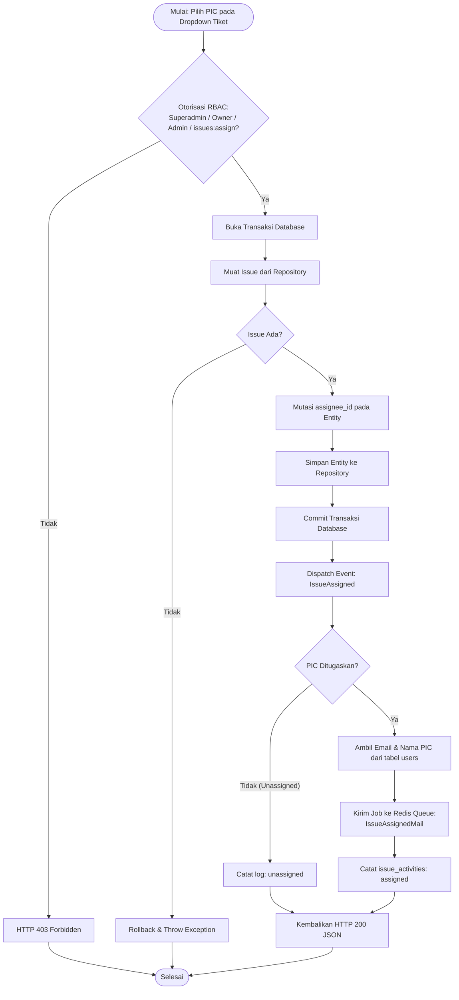
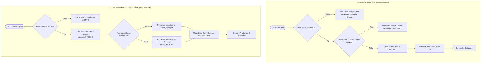
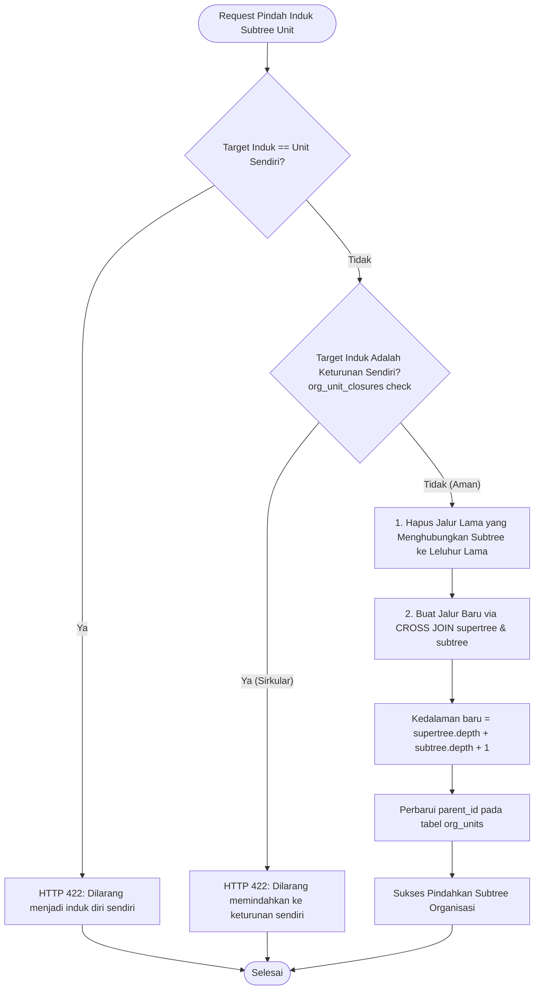
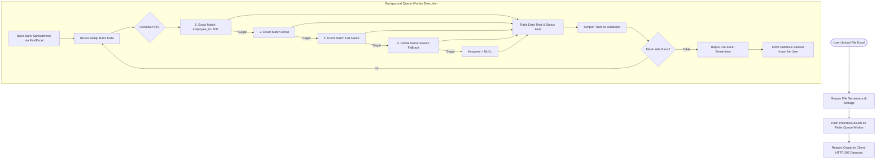

# Activity Diagrams (Workload & Identity Core Processes)

## Workload & Learning Management System (WLMS)

Dokumen ini mendefinisikan diagram aktivitas (_Activity Diagrams_) dalam format Mermaid untuk proses-proses bisnis terpenting di WLMS.

---

## 1. Pembuatan Tiket Baru (`CreateIssueUseCase`)

---

## 2. Transisi Status Alur Kerja Tiket (`TransitionIssueStatusUseCase`)

---

## 3. Penugasan PIC Tiket & Email Asinkron (`AssignIssueUseCase`)

---

## 4. Siklus Hidup Sprint (_Sprint Lifecycle: Start & Complete_)

---

## 5. Pemindahan Subtree Pohon Organisasi (`OrgUnitTreeService::moveSubtree`)

---

## 6. Impor Spreadsheet Excel Latar Belakang (`ImportIssuesJob`)

