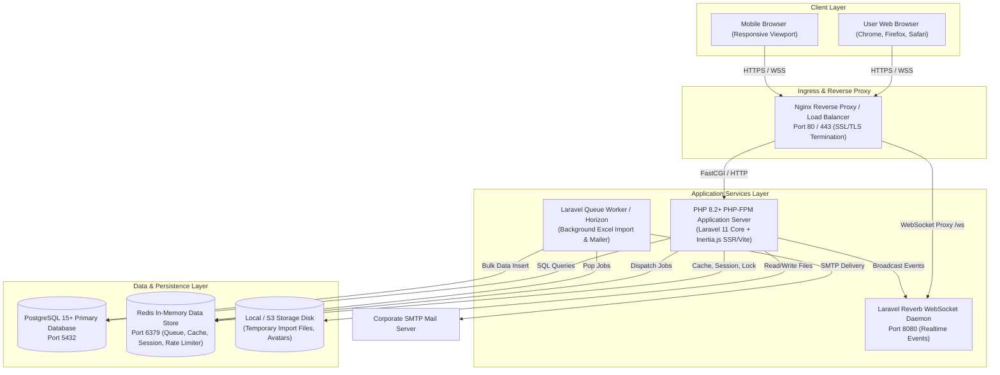

# Deployment Topology & Runtime Infrastructure

## Workload & Learning Management System (WLMS)

Dokumen ini mendefinisikan topologi runtime, orkestrasi proses latar belakang, dan konfigurasi infrastruktur sistem WLMS.

---

## 1. Diagram Topologi Runtime (Deployment Diagram)



---

## 2. Rincian Proses & Daemon Layanan

### 2.1 Web Server (Nginx + PHP-FPM)

- **Tanggung Jawab**: Melayani HTTP request, terminasi SSL/TLS, menyajikan file statis (Vite build assets: JS/CSS), dan mem-proxy request dinamis ke PHP-FPM.
- **Konfigurasi Nginx WebSocket**:
    ```nginx
    location /ws {
        proxy_pass http://127.0.0.1:8080;
        proxy_http_version 1.1;
        proxy_set_header Upgrade $http_upgrade;
        proxy_set_header Connection "Upgrade";
        proxy_set_header Host $host;
    }
    ```

### 2.2 Worker Antrean Latar Belakang (_Queue Worker_)

- **Perintah Eksekusi**: `php artisan queue:work --tries=3 --timeout=300 --queue=default,imports,notifications`
- **Tanggung Jawab**:
    1. `ImportProjectsJob` & `ImportIssuesJob`: Membaca dan memproses spreadsheet Excel ratusan baris di latar belakang agar antarmuka web tidak mengalami _timeout_ HTTP 504.
    2. `IssueAssignedMail`: Mengirim email penugasan ke SMTP tanpa memblokir respon HTTP pengguna.

### 2.3 Layanan Real-Time WebSocket (Laravel Reverb)

- **Perintah Eksekusi**: `php artisan reverb:start --host=0.0.0.0 --port=8080`
- **Tanggung Jawab**: Memancarkan event state papan Kanban, pergeseran status tiket, dan notifikasi in-app ke browser pengguna yang sedang membuka ruang kerja terkait secara real-time.

---

## 3. Matriks Konfigurasi Lingkungan (`.env`)

| Kunci Konfigurasi      | Nilai Produksi Direkomendasikan | Tujuan                                                                 |
| ---------------------- | ------------------------------- | ---------------------------------------------------------------------- |
| `APP_ENV`              | `production`                    | Mengaktifkan optimasi cache Laravel, menonaktifkan debug stack traces. |
| `APP_DEBUG`            | `false`                         | Mencegah kebocoran struktur data dan kredensial.                       |
| `DB_CONNECTION`        | `pgsql`                         | Driver database PostgreSQL untuk integritas transaksional tinggi.      |
| `QUEUE_CONNECTION`     | `redis`                         | Driver antrean berkinerja tinggi untuk background jobs.                |
| `CACHE_STORE`          | `redis`                         | Penyimpanan cache query dan rate limiter bucket.                       |
| `SESSION_DRIVER`       | `redis`                         | Manajemen sesi multi-server yang stateless di level web server.        |
| `BROADCAST_CONNECTION` | `reverb`                        | Driver websocket native Laravel.                                       |
| `MAIL_MAILER`          | `smtp`                          | Pengiriman email penugasan tiket (`IssueAssignedMail`).                |
