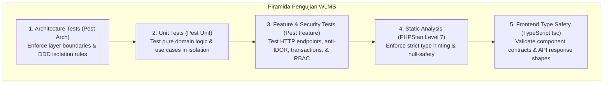

# Test Strategy & Quality Assurance Matrix

## Workload & Learning Management System (WLMS)

**Rangkaian Uji Aktif:** 169 Tests Passed | 731 Assertions | 0 Failures  
**Static Analysis:** PHPStan Level 7 (0 Errors)  
**Frontend Types:** TypeScript Compiler `tsc --noEmit` (0 Errors)

---

## 1. Piramida Pengujian WLMS (Testing Pyramid)

WLMS menerapkan pendekatan pengujian bertingkat (_multi-tiered quality assurance_) untuk menjamin keandalan kode sebelum masuk ke produksi:

---

## 2. Rincian Lapisan Pengujian

### 2.1 Lapisan 1: Pengujian Arsitektur (Architecture Tests)

- **Lokasi**: [`tests/Arch/ArchitectureTest.php`](file:///Users/robileksono/Sites/wlms/tests/Arch/ArchitectureTest.php) dan [`tests/Arch/WorkloadArchitectureTest.php`](file:///Users/robileksono/Sites/wlms/tests/Arch/WorkloadArchitectureTest.php)
- **Tujuan**: Menjamin tidak ada pelanggaran Clean Architecture secara mekanis:
    1. Lapisan `Domain` dilarang mengimpor kelas dari `Infrastructure`, `Application`, `Presentation`, atau `Illuminate`.
    2. Lapisan `Application` dilarang bergantung pada `Presentation` atau implementasi repositori konkret.
    3. Controller dilarang memuat model Eloquent secara langsung pada lapisan bisnis.
    4. Namespace `Shared` dilarang bergantung pada modul internal.

### 2.2 Lapisan 2: Pengujian Unit Use Case (Unit Tests)

- **Lokasi**: `tests/Unit/Modules/Workload/Application/`
- **Cakupan Pengujian**:
    - `CreateIssueUseCaseTest.php`: Validasi proyek tidak ditemukan, proyek diarsipkan, nomor sekuensial unik, dan inisialisasi status alur kerja pertama.
    - `TransitionIssueStatusUseCaseTest.php`: Menolak transisi ilegal dengan `InvalidTransitionException` dan memverifikasi mutasi status yang valid.
    - `AssignIssueUseCaseTest.php`: Memverifikasi penugasan ke user dan unassign (`null`).
    - `DeleteIssueUseCaseTest.php`: Memverifikasi soft-delete tiket via repositori.
    - `LogWorkUseCaseTest.php`: Memverifikasi pencatatan log kerja dan pengurangan atomik pada `remaining_estimate_seconds`.
    - `CreateWorkspaceUseCaseTest.php`: Validasi pembentukan workspace dan penetapan admin awal.

### 2.3 Lapisan 3: Pengujian Fitur & Otorisasi (Feature Tests)

- **Lokasi**: `tests/Feature/Modules/`
- **Cakupan Kunci**:
    - `WorkspaceMultiViewTest.php`:
        - **Anti-IDOR Verification**: Memverifikasi bahwa user dari Divisi B yang mencoba mengakses board, backlog, issues, atau timeline proyek Divisi A menerima respon `403 Forbidden`.
        - **Pagination & Limit Safeguards**: Memverifikasi endpoint tidak melakukan pemotongan diam-diam (_silent truncation_) pada dataset 20+ tiket saat dipanggil dengan parameter `limit=500`.
        - **Multi-attribute PIC Resolution**: Menguji pencocokan penugasan tiket pada impor Excel melalui NIP, email, dan nama lengkap.
    - `IssueApiSecurityTest.php` & `SprintApiSecurityTest.php`: Pengujian izin dinamis RBAC untuk modifikasi sprint dan penugasan tiket.
    - `OrgStructureTest.php`: Pengujian penambahan dan pemindahan subtree hierarki organisasi tanpa referensi sirkular.

### 2.4 Lapisan 4 & 5: Static Analysis & Type Checking

- **PHPStan (Level 7)**:
  `php -d memory_limit=512M ./vendor/bin/phpstan analyse --debug --no-progress`
  Memastikan setiap pemanggilan metode, properti, dan tipe kembalian memiliki kepastian tipe tanpa `mixed` yang tidak aman.
- **TypeScript (`tsc --noEmit`)**:
  `npm run types:check`
  Memverifikasi 100% keselarasan props komponen antarmuka React dengan kontrak data backend.

---

## 3. Matriks Eksekusi & Gate CI/CD

| Perintah Pengujian                                      | Waktu Eksekusi Standar | Kriteria Kelulusan (Gate)                        |
| ------------------------------------------------------- | :--------------------: | ------------------------------------------------ |
| `./vendor/bin/pest tests/Arch`                          |         ~2.5s          | 100% Pass (0 pelanggaran arsitektur)             |
| `./vendor/bin/pest tests/Unit`                          |         ~1.5s          | 100% Pass                                        |
| `./vendor/bin/pest tests/Feature`                       |         ~3.8s          | 100% Pass (Semua endpoint 200/403 terverifikasi) |
| `php -d memory_limit=512M ./vendor/bin/phpstan analyse` |         ~5.0s          | 0 Errors (Level 7)                               |
| `npm run types:check`                                   |         ~3.5s          | 0 Errors                                         |
| **Total Rangkaian Otomatis**                            |     **< 17 detik**     | **Semua Lulus (Siap Deploy)**                    |
